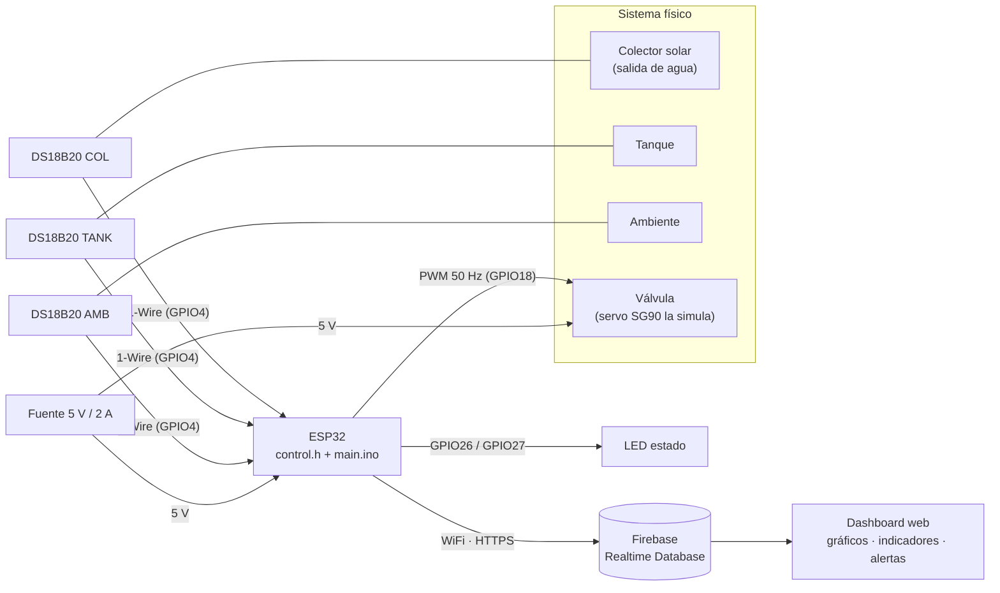

# Arquitectura del sistema

## Flujo de información y energía



| Flujo | Camino |
|---|---|
| **Información** | Sondas → ESP32 → Firebase → Dashboard |
| **Decisión** | ESP32 calcula ΔT = T_col − T_tanque y decide abrir o cerrar |
| **Acción física** | ESP32 → servo → posición de la válvula |
| **Energía** | Fuente 5 V → ESP32 (VIN) y servo; sondas y pull-up desde 3V3 del ESP32 |

## Lógica de control (histéresis diferencial)

| Estado actual | Condición | Nuevo estado |
|---|---|---|
| Cerrada | ΔT ≥ 5 K (hay sol) | **Abre** |
| Abierta | ΔT ≤ 2 K (cae el sol) | **Cierra** |
| Cualquiera | 2 K < ΔT < 5 K | Mantiene (banda muerta) |
| Cualquiera | Falla de sonda (colector o tanque) 3 ciclos seguidos | **Abierta** (modo seguro) |
| Cualquiera | Tanque ≥ 65 °C | **Cierra** hasta bajar a 60 °C |

Se agrega un tiempo mínimo de 60 s entre movimientos para proteger el servo. Los cambios por seguridad ignoran ese tiempo.

**Por qué esta lógica y no PID:** la variable a controlar es un estado discreto (abierta o cerrada), no una referencia continua. Según la clase de electrónica, «el mejor controlador es el más simple que satisface los requerimientos»: umbral con histéresis. La banda de 3 K es mayor que el error combinado de dos sondas (±0.5 °C cada una), por lo que el ruido no produce conmutaciones.

## Esquema de datos en Firebase

```
/lecturas/<id-cronológico>
    ts    epoch en segundos (UTC)
    tc    T colector [°C]   (null si la lectura es inválida)
    tt    T tanque [°C]
    ta    T ambiente [°C]
    v     1 = válvula abierta · 0 = cerrada
    f     bits de falla: 1 colector · 2 tanque · 4 ambiente
    rssi  intensidad WiFi [dBm]
    cl    contador de cierres de la válvula
/estado   (última muestra subida; mismo formato)
```

Periodo de muestreo: 10 s (≈ 8 640 registros por día). Las temperaturas del tanque cambian con constantes de tiempo de minutos, por lo que 10 s respeta el criterio de muestreo con amplio margen.

## Robustez
- **Cola local de 180 muestras (30 min)** si se cae el WiFi; se envían al reconectar.
- **Modo seguro (fail-open)** ante falla de sensor.
- **LED rojo** parpadea con falla de sensor o sin WiFi.
- **Direcciones ROM** fijas por sonda para no confundir colector con tanque.

## Indicadores que genera el dashboard
| Indicador | Qué responde |
|---|---|
| Flujo inverso evitado [h] | Cuánto tiempo la válvula cerrada impidió que el tanque perdiera calor por el colector |
| Horas captando calor | Tiempo con la válvula abierta y el colector al menos 2 K sobre el tanque |
| Flujo inverso con válvula abierta [h] | Si el control reacciona tarde o los umbrales están mal |
| Cierres de la válvula | Cantidad de conmutaciones (desgaste, oscilaciones) |
| Temperatura máxima del tanque | Si se alcanza el objetivo de agua caliente (≥ 45 °C) |
| Calor almacenado neto [kWh] | Energía ganada por el tanque (depende del volumen configurado) |
